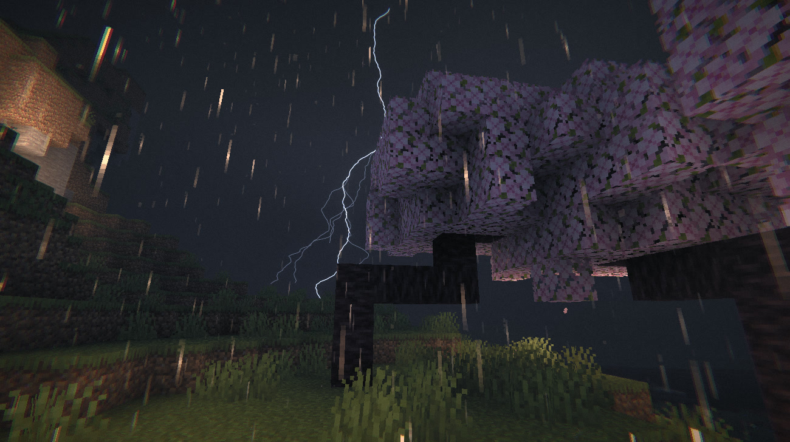
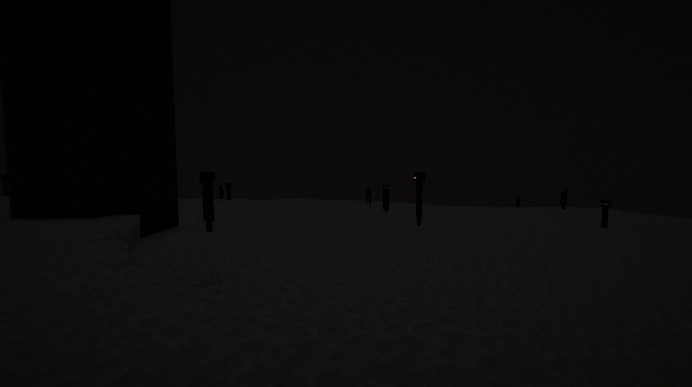
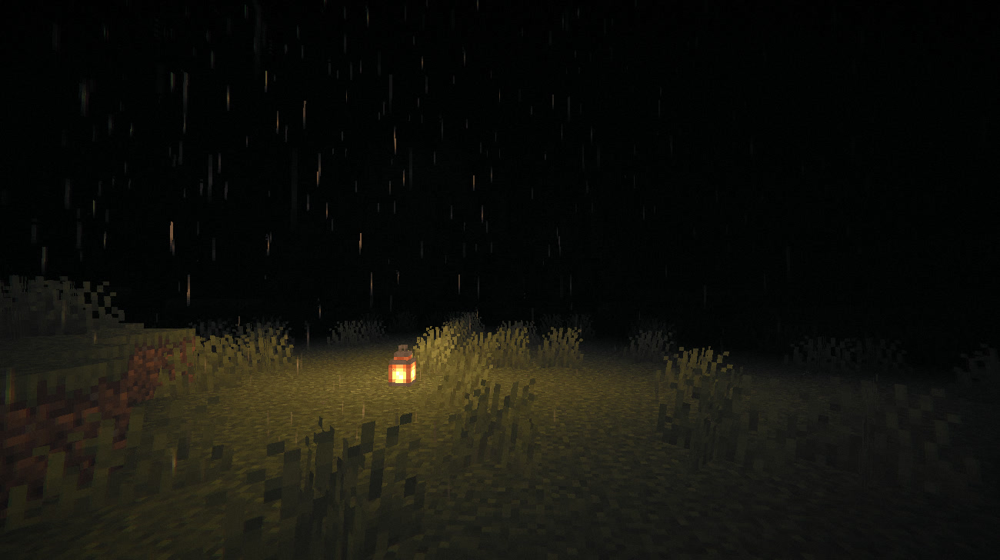
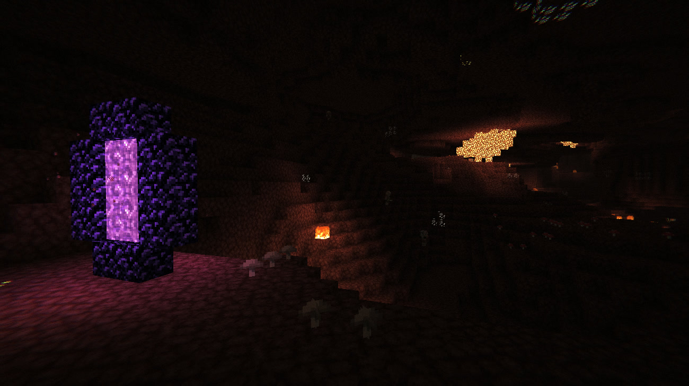
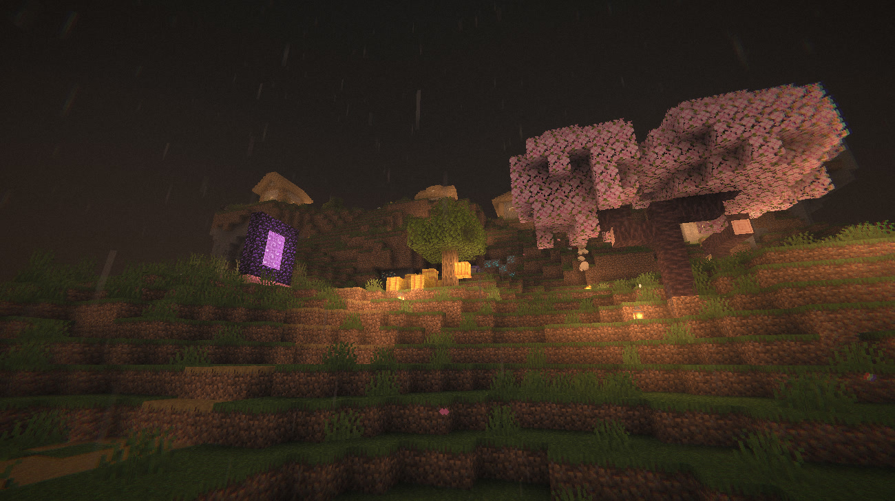
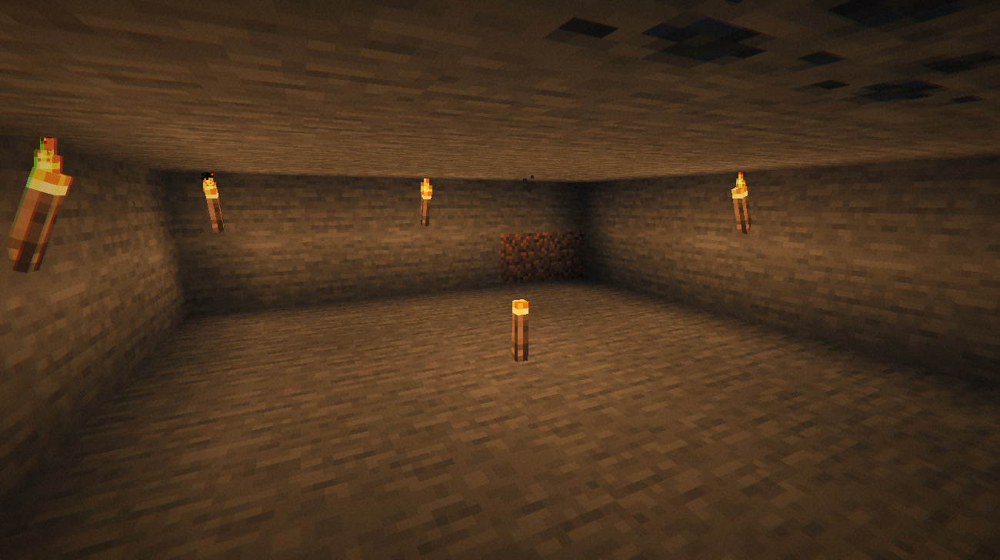
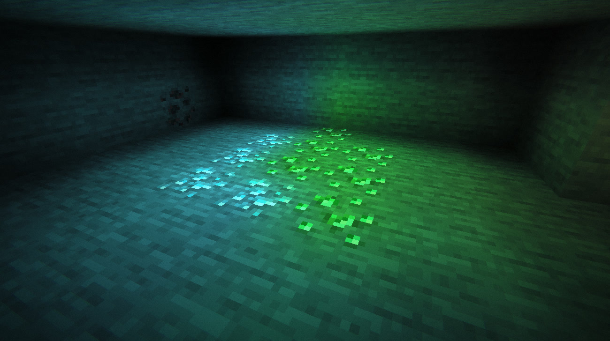

# Deathly Hallows (Русский)

Лёгкий и очень атмосферный шейдер для Minecraft (Iris). Пасмурные дни, холодные синие ночи, светящиеся в темноте руды и тяжёлый дождь: мир, в котором не хочется оставаться под открытым небом, при этом без просадок FPS.

**Версия 2.3.1**

## Чем хорош

- **Лёгкий для видеокарты.** Нет карт теней, трассировки лучей и отложенного освещения. Небо, туман и освещение считаются раз за кадр и общие для всех вершин, а отключённые эффекты ничего не стоят. В настройках названия опций окрашены по нагрузке (зелёный: бесплатно, жёлтый: небольшая цена, красный: тяжёлая).
- **Атмосфера прежде всего.** Приглушённая десатурированная палитра, мягкие градиенты с дизерингом, плёночное зерно и виньетка дают кинематографичную, чуть мрачную картинку.
- **Тёмная ночь и мутная вода.** Ночь здесь по-настоящему тёмная, как в реальной жизни: без факела или костра почти ничего не видно. Вода очень мутная, дно быстро пропадает из виду.
- **Всё настраивается.** Если такой стиль не по вкусу, более 80 опций со слайдерами позволяют сделать картинку такой, как хотите: посветлить ночь, прояснить воду, убрать пасмурность и многое другое. 8 языков.

## Возможности

**Небо и время суток**
- Пасмурный день со статичной пеленой облаков вместо ванильных
- Закатный и синий час с настраиваемой силой и длиной
- Тёмные холодные ночи, настройка дневного света в пещерах

**Погода**
- Дождевая дымка вокруг игрока, исчезающая в пещерах
- Тонкий серый дождь, тёплый у огня
- Реалистичная молния с ветвями, повторными вспышками и подсветкой неба
- Опциональный снег на местности и иней на листве

**Динамический свет и свечение**
- Цветной динамический свет от предметов в руках (факелы, фонари, ведро лавы, фрогсветы, огонь душ и др.), в том числе у мобов и в рамках
- Мерцание света факелов и костров
- Светящиеся в темноте руды, опциональный цветной свет руд, расходящийся по пещере
- Светящийся редстоун, портал в ад с фиолетовым светом на соседних блоках, светящиеся глаза мобов
- Рассеивание света огня в дождевой дымке

**Мир**
- Тёмная коричневая мутная вода с мутностью по глубине
- Покачивающиеся листва и растения, сильнее в шторм
- Марево в Незере, холодный фиолетовый Энд

**Камера и интерфейс**
- Плёночное зерно, хроматическая аберрация, виньетка, опциональные свечение, FXAA и резкость
- Эффект низкого здоровья с пульсом сердца и эффект нехватки воздуха

## Скриншоты

## Установка

1. Установите [Iris](https://www.irisshaders.dev/).
2. Заархивируйте папку `shaders` (в корне архива должна лежать `shaders/`) или запустите `./setup.sh`, чтобы собрать и установить архив.
3. Положите zip в `.minecraft/shaderpacks` и выберите его в Настройки видео > Шейдеры.

Нужен Iris. Динамический свет предметов, свет порталов и руд использует SSBO и compute-шейдеры, поэтому на других загрузчиках эти части недоступны. Остальное работает и без них.

Поддерживается [Distant Horizons](https://modrinth.com/mod/distanthorizons): дальние LOD получают то же освещение, туман, снег и мутную воду, а туман отодвигается к границе дальности DH.

## Мод-дополнение

В папке `mods/` лежит необязательный клиентский мод для Fabric (Minecraft 1.21.1), дополнение к шейдеру. Версия мода совпадает с версией шейдера: `deathlyhallows_2.3.1.jar` для шейдера V2.3.1.

- **Realistic Thunder**: гром слышен только когда звук дошел до игрока (скорость звука настраивается, по умолчанию 300 м/с), дальний гром тише и глуше.
- **Distant Lightning**: во время грозы симулирует удары молний на расстоянии до 20 км: слабая вспышка у горизонта и запоздалый раскат.

- **Custom Weather**: частота дождя и гроз настраивается: никогда, редко, по умолчанию, часто, постоянно. В одиночной игре подменяется погодный цикл встроенного сервера, так что погода настоящая (мобы, посевы, молнии), команды `/weather` продолжают работать. На чужих серверах погода симулируется на клиенте: дождь, небо, звуки и шейдер следуют своему циклу, а при частых грозах молнии бьют и рядом (от 100 м). Гроза без дождя невозможна: при дожде «никогда» гроз тоже нет, а частые грозы приносят дождь с собой.

- **Smaller Shield**: щит в левой руке уменьшается (50-90%, по умолчанию 80%), пока вы не блокируете им, и плавно возвращается к полному размеру при блоке.

- **Campfire Cooking**: еда на костре постепенно превращается из сырой в готовую (текстура сырого предмета плавно перетекает в готовую). Прогресс считается на клиенте: еда, которая уже готовилась, когда вы подошли, начнет с нуля.
- **Mob Health Bars** (по умолчанию выключено): красная полоска здоровья над мобом, которого вы ранили (в ближнем бою или снарядом), пока вы рядом (8-32 блока). Недавно потерянное здоровье светлым хвостом сжимается к текущему.
- **Crop Markers**: зеленая галочка над полностью выросшей пшеницей, морковью, картошкой и свеклой в радиусе 16 блоков. Пропадает, как только урожай сломан. Размер (50-200%) и непрозрачность (по умолчанию 50%) настраиваются.
- **Realistic Sleep** (только одиночная игра и LAN): ночь не пропускается, а проходит ускоренно, пока вы спите (вся ночь за 10-60 секунд, по умолчанию 20; если компьютер не тянет столько тиков, время суток, рост растений и печи ускоряются сверх тикрейта). Растут посевы и тростник, работают печи, живут мобы. Просыпаетесь на рассвете, как в ванили. **Sleep Camera**: камера уходит из кровати на улицу (перелетает, если путь свободен, иначе через затемнение) и показывает, как ночь сменяется днем; если открытого неба рядом нет, остается в кровати. **Night Dangers** (по умолчанию выключено): монстр, который может дойти до кровати (открытая дверь, дыра в стене), может найти вас во сне и разбудить ударом, а зашипевший рядом крипер будит сразу. Когда кто-то идет к спящему, ночь замедляется до обычной скорости. Без этой опции монстры спящих не трогают.

Настройки открываются через [Mod Menu](https://modrinth.com/mod/modmenu). Сборка: `mods/build.sh` (jar в `mods/build/`), установка в `~/.minecraft/mods`: `mods/install.sh`.

## Структура проекта

- `shaders/`: сам шейдер. Общий код в `shaders/lib/`, опции в `shaders/lib/settings.glsl`.
- `lang_src/`: читаемые переводы в UTF-8; `lang_src/gen.py` собирает из них `shaders/lang/*.lang`.
- `setup.sh`: собирает zip и устанавливает его в папку шейдеров.
- `mods/`: мод-дополнение для Fabric.

---

# Deathly Hallows (English)

A lightweight, deeply atmospheric shader pack for Minecraft (Iris). Gloomy overcast days, cold blue nights, glowing ores in the dark and heavy rain: it is built to feel like a world you would rather not be caught outside in, without eating your framerate.

**Version 2.3.1**

## Why it is good

- **Light on the GPU.** No shadow maps, no ray marching, no deferred lighting pass. Sky, fog and lighting are computed once per frame and shared by all vertices, and every optional effect is off the hot path when disabled. In the settings, option names are colored by their performance cost (green = free, yellow = small cost, red = heavy).
- **Atmosphere first.** A moody desaturated palette, soft dithered gradients, film grain and a vignette give the whole image a cinematic, slightly bleak look.
- **Truly dark nights and murky water.** Night here is really dark, like in real life: without a torch or a campfire you can barely see anything. The water is very murky and the bottom quickly disappears from view.
- **Everything is tunable.** If that style is not for you, 80+ options with sliders let you shape the image however you like: brighten the night, clear up the water, tone down the gloom and much more. 8 languages.

## Features

**Sky and time of day**
- Overcast daylight with a static nimbostratus deck instead of vanilla clouds
- Orange hour and blue hour twilight with adjustable strength and length
- Dark, cold nights and cave daylight control

**Weather**
- Rain haze that rolls in around the player and disappears in caves
- Thin, grayish rain that glows warmly near fire
- Realistic lightning with branches, repeated flashes and sky flashes
- Optional snow cover on terrain and frost on foliage

**Dynamic light and glow**
- Colored dynamic light from held items: torches, lanterns, lava bucket, froglights, soul fire and more, also from mobs and item frames
- Flickering light of torches and campfires
- Glowing ores that you can see in the dark, with optional colored ore light spreading through the cave
- Glowing redstone, nether portals with purple light on nearby blocks, glowing mob eyes
- Fire light scattering in the rain haze

**World**
- Dark brown murky water with depth-based murk
- Swaying leaves and plants that gust harder in storms
- Heat haze in the Nether, a cold purple End

**Camera and interface**
- Film grain, chromatic aberration, vignette, optional glow, FXAA and sharpening
- Low health effect that pulses with a heartbeat, and a low air effect

## Screenshots

## Installation

1. Install [Iris](https://www.irisshaders.dev/).
2. Zip the `shaders` folder (the zip must contain `shaders/` at its root), or run `./setup.sh` to build and install the archive.
3. Put the zip into `.minecraft/shaderpacks` and select it in Video Settings > Shader Packs.

Iris is required. Dynamic held-item light, portal light and ore light rely on SSBOs and compute shaders, so these parts are unavailable on other loaders. The rest of the pack works without them.

## Companion mod

The `mods/` folder holds an optional client-side Fabric mod (Minecraft 1.21.1), a companion to the shader pack. The mod version matches the shader version: `deathlyhallows_2.3.1.jar` goes with shader V2.3.1.

- **Realistic Thunder**: thunder is heard only once its sound reaches the player (configurable speed of sound, 300 m/s by default); distant thunder is quieter and lower.
- **Distant Lightning**: simulates strikes up to 20 km away during thunderstorms: a dim flash near the horizon and a delayed rumble.
- **Campfire Cooking**: food on a campfire gradually turns from raw into cooked (the texture of the raw item gradually turns into the cooked one). Progress is tracked on the client, so food that was already cooking when you walked up starts from zero.
- **Mob Health Bars** (off by default): a red health bar over a mob you hurt (melee or projectile) while you are near it (8-32 blocks). Recently lost health shows as a pale trail shrinking to the current value.
- **Crop Markers**: a green check mark over fully grown wheat, carrots, potatoes and beetroots within 16 blocks. It disappears as soon as the crop is broken. Size (50-200%) and opacity (50% by default) are configurable.
- **Realistic Sleep** (singleplayer and LAN only): the night is not skipped but passes fast while you sleep (a whole night in 10-60 seconds, 20 by default; when the computer cannot run that many ticks, the time of day, crop growth and furnaces are sped up beyond the tick rate). Crops and sugar cane grow, furnaces smelt, mobs live on. You wake at dawn, like in vanilla. **Sleep Camera**: the camera leaves the bed for a spot outside (it flies there when the way is clear, otherwise it dips to black) and shows the night turning into day; with no open sky nearby it stays in bed. **Night Dangers** (off by default): a monster that can walk up to your bed (an open door, a hole in the wall) may find you in your sleep and wake you with a hit, and a creeper that starts hissing next to you wakes you at once. While something is coming for a sleeper the night slows down to normal speed. With the option off monsters leave sleepers alone.

Settings open through [Mod Menu](https://modrinth.com/mod/modmenu). Build with `mods/build.sh` (jar goes to `mods/build/`), install into `~/.minecraft/mods` with `mods/install.sh`.

## Project layout

- `shaders/`: the shader pack itself. Shared code is in `shaders/lib/`, options are in `shaders/lib/settings.glsl`.
- `lang_src/`: readable UTF-8 translations; `lang_src/gen.py` builds `shaders/lang/*.lang` from them.
- `setup.sh`: builds the zip and installs it into the shaderpacks folder.
- `mods/`: the companion Fabric mod.
